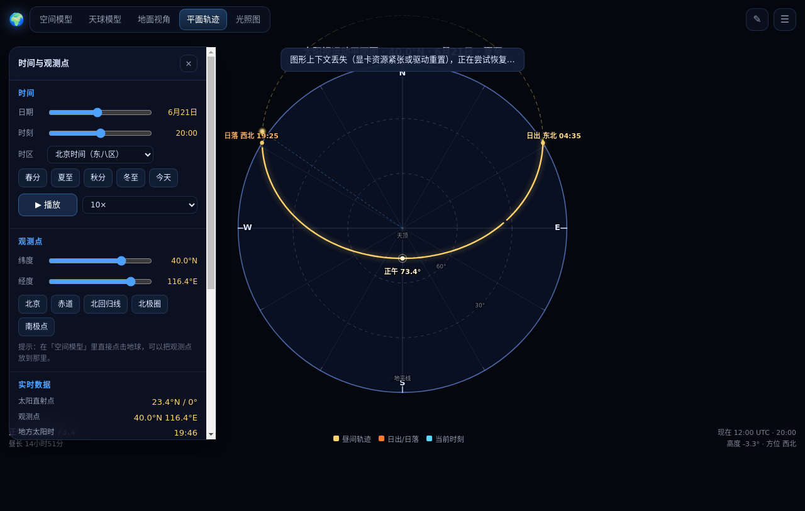
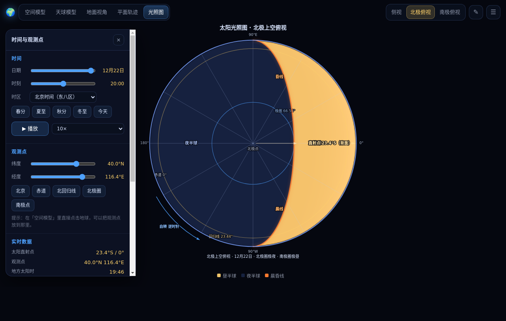
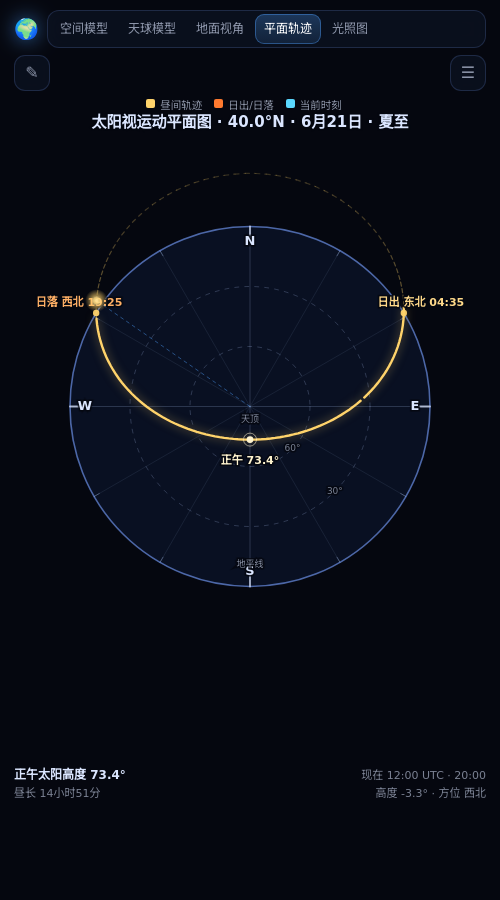

# 3D 地球 · 地球的运动（高中地理教具）

一个可以离线双击打开的单文件网页教具，用 **5 个模型** 多角度讲清「地球的自转与公转、昼夜交替、晨昏线、太阳视运动」。

- **单文件版**：`dist/earth-3d.html`（约 2.9 MB，three.js、脚本、贴图全部内联，双击即开，不需要联网）
- **开发版**：`index.html`（需要本地静态服务器，贴图从 `textures/` 读）

## 五个模型

| 模型 | 内容 | 适合讲 |
| --- | --- | --- |
| 空间模型 (M1) | 真实地形贴图 3D 地球：日半球/夜半球/晨昏线/晨昏线暖色带/云层/星空/太阳平行光线/经纬网（赤道、回归线、极圈） | 昼夜交替、晨昏线性质、直射点、五带 |
| 天球模型 (M2) | 天球 + 地平圈 + 太阳一日视运动轨迹 + 日出日落方位 + 正午高度角 | 太阳视运动图、日出日落方位 |
| 地面视角 (M3) | 第一人称：天空颜色随太阳高度变化、标杆与影长、影子方向 | 正午太阳高度、影长变化 |
| 平面轨迹 (M4) | Canvas 2D 极坐标太阳视运动图（方位-高度），标出日出、日落、正午 | 会画「太阳视运动图」这道高频题 |
| 光照图 (M5) | 北极/南极上空俯视的逐像素昼夜光照图：昼半球、夜半球、晨昏线、直射点、自转方向 | 光照图判读、极昼极夜、直射点移动 |

M1 与 M5 支持 **侧视图 / 北极俯视 / 南极俯视** 三种视角切换；3D 模型支持鼠标拖拽旋转、滚轮 / 双指缩放。

## 界面功能

- **时间**：日期滑块（1–365 天）、时刻滑块、时区选择（东八区 / 中时区 / 西五区）、春分 / 夏至 / 秋分 / 冬至 / 今天一键预设、播放（1× / 10× / 60×）
- **观测点**：纬度、经度滑块，快捷地点（北京 / 赤道 / 北回归线 / 北极圈 / 南极点）；在 M1 里**直接点击地球**也能把观测点放到那里
- **实时数据**：太阳直射点、太阳高度角、方位、地方太阳时、区时、昼长、日出日落、正午太阳高度、五带、节气（近似）
- **考点练习**：按当前时空自动生成 4 道选择题，带解析
- **URL 参数**（方便课前把情景存成链接）：
  `?model=M1..M5&date=172&time=12&lat=40&lon=116.4&tz=8&view=side|north|south&play=1&night=0&clouds=0&graticule=0&terminator=0&zones=1&quiz=1&nosplash=1`
  例：`dist/earth-3d.html?model=M1&date=172&time=12&lat=23.5&lon=0&view=north`

## 预览

太阳视运动平面图（M4）



北极上空光照图（M5）



手机端（M4）



## 数据与算法

- 太阳赤纬：`δ = 23.44° × sin((360/365)(284 + N)°)`（N 为一年中的第几天）
- 太阳高度角：`sin h = sinφ·sinδ + cosφ·cosδ·cos t`（t 为时角）
- 方位角：`atan2(−cosδ·sin t, sinδ·cosφ − cosδ·sinφ·cos t)`
- 昼长：由 `cos H₀ = −tanφ·tanδ` 求半日弧再乘 2；正午太阳高度 `90° − |φ − δ|`
- 直射点经度：`180° − 15° × UTC 小时`；五带界线 23.44° / 66.56°
- 24 节气为近似表（用于读数「节气（近似）」）

## 贴图来源

`textures/` 内 5 张 2K 贴图来自 three.js examples（原始数据为 NASA Visible Earth，公有领域）：
日间 `earth_day.jpg`、夜景灯光 `earth_night.png`、法线 `earth_normal.jpg`、海洋高光 `earth_specular.jpg`、云层 `earth_clouds.png`。
详见 `textures/SOURCES.md`。

## 构建 / 测试

```bash
node build.mjs            # 生成 dist/earth-3d.html（内联全部脚本 + base64 贴图）
python3 -m http.server 8123   # 开发版：浏览器打开 http://127.0.0.1:8123/index.html
```

自检页：把 `src/selftest.js` 注入 `index.html` 的 `</body>` 前生成 `selftest.html`，用无头浏览器 `--dump-dom` 抓 `<pre id="testOut">`，
覆盖模块加载、天文数值、读数文本、视角切换、各模型渲染、Canvas 像素、极昼极夜、题库字段等（当前 31 PASS / 2 FAIL，失败项只与无头环境 WebGL 不可用有关）。

## 目录

```
index.html        开发版模板
styles.css        样式（深色玻璃拟态，<820px 自动变手机布局）
build.mjs         单文件构建脚本
src/astro.js      天文计算（赤纬、时角、高度角、方位角、昼长、节气）
src/helpers.js    公共工具（标签、线、太阳精灵、可拖拽轨道相机、配色）
src/m1-earth.js   M1 空间模型（自定义 shader 昼夜混合）
src/m2-sky.js     M2 天球模型
src/m3-ground.js  M3 地面视角
src/m4-chart.js   M4 太阳视运动平面图（Canvas 2D）
src/m5-cross.js   M5 光照图（逐像素昼夜着色）
src/quiz.js       考点题库生成器
src/app.js        主控：状态、贴图、模型切换、主循环、UI、读数
dist/earth-3d.html  单文件成品（离线可用）
```

## 已知限制

- 3D 模型依赖 WebGL；极少数老设备/关闭硬件加速的浏览器会提示「没有开启 WebGL」，此时 M4、M5 两个 2D 模型仍可用。
- 同一页面不要同时打开多个 3D 教具标签页，低端机可能因显卡资源紧张丢失 WebGL 上下文（失去后会提示并尝试恢复）。
- 节气为近似值；太阳视运动按「太阳为点光源、忽略大气折射」的教科书模型计算，与真实日出日落时刻有几分钟差异。
